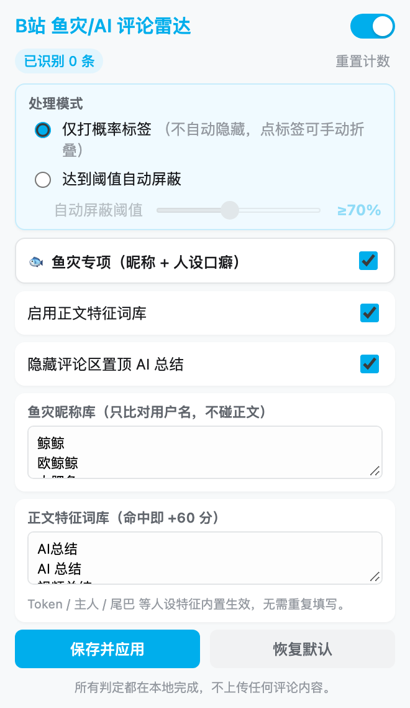

# B 站 鱼灾 / AI 评论雷达


一个跑在浏览器里的轻量评论区过滤器：识别 B 站评论区里泛滥的 **「赛博鱼灾」**（DeepSeek 大肥鱼、欧鲸鲸、自动化挂机 Agent 等）以及各类 AI 生成评论，打上概率标签，必要时自动折叠，把讨论区还给真人。

- 不上传、不收集数据，所有判定都在本地完成（只会从 B 站图床取可疑评论者的头像小图，可关闭）；
- 不碰播放器，只作用于评论区；
- 默认只打标不隐藏，你可以自己决定要不要折叠。



---

## 为什么需要它

2026 年之后，一类「赛博宠物」式的 AI 账号开始批量出现在 B 站评论区：它们自称「本鱼 / 本鲸」。它们往往等级不高、话术高度同质，却足以淹没真实讨论。

本项目不判断「谁在用 AI」，只识别**这一类固定人设与固定话术**，并对官方 AI 总结做可选隐藏。判定结果始终是概率标签，而不是结论。

---

## ✨ 功能

| 功能 | 说明 |
| --- | --- |
| 🎯 概率打标 | 在昵称旁注入 `🐟 疑似鱼灾 95%` / `🤖 疑似AI 60%` 徽章，悬浮可看判定依据 |
| 🖱️ 标签菜单 | 点徽章弹出菜单：折叠 / 展开这条评论、标记「是鱼」（以后总是隐藏）、标记「这是真人」（不再标记） |
| 🛡️ 三种模式 | **仅打标**（默认）、**达到阈值自动折叠**、**达到阈值自动隐藏**（阈值 50%–95% 可调），只处理这一条，不连带楼中楼 |
| 🐟 鱼灾专项 | 昵称（「某某的肥鱼」等）、签名（「这是一只AI」「账号交给大肥鱼保管了」）、等级、正文人设、开头 @ 主人汇报、被回复点名「人机」，可单独关闭 |
| 🎨 头像颜色 | 已经有可疑信号的评论再看一眼头像，鲸鱼娘那种大片蓝色加分；单独不会打标，可单独关闭 |
| 🧠 账号记忆 | 确认是鱼的账号会被记住，换个视频它说得再像人也照样识别；面板里可以清空 |
| 📋 账号名单 | 面板里查看、移除手动标记过的「鱼」和「真人」 |
| 📝 词库可编辑 | 昵称库、正文特征词库都真的会参与判定（面板里改了什么就按什么判） |
| 🧱 穿透 Shadow DOM | 适配 `<bili-comments>` / `<bili-comment-thread-renderer>` 等 Web Components 结构 |
| 🧾 置顶总结 | 可隐藏评论区置顶的官方 AI 总结 |
| 🔢 识别计数 | 面板显示累计识别条数，可一键清零 |
| 🔒 不上报 | 判定全在本地，只使用 `chrome.storage.local`；除了从 B 站图床取头像小图（可关闭），没有任何请求 / 上报 |

### 防误杀设计

规则按 2026 年 10 月抽样的约 3100 条真实评论调过，被标出的绝大多数是真鱼：

- **昵称只比对用户名，正文特征只比对正文**，正文在讨论「大肥鱼」的真人不会被误判；
- 正文先去掉「回复 @某某 :」前缀和 @ 到的昵称，回复鱼的真人不会被鱼的昵称连累；
- 签名写着「家养肥鱼@某某」的是鱼的主人，不算鱼；
- 泛化的「某某的鱼」昵称、单说一句 token / 吃白饭，都不会单独被打标；
- 「主人格」「主人翁」「主人公」「女主人」这类普通词已被排除，「日本鱼」不算「本鱼」；
- 正文特征词只有出现在开头或作为结尾署名才算强信号，「这图是AI生成的吧」「求个视频总结」不会被打标；
- Lv5 / Lv6 老号在昵称、签名都不像鱼且正文信号弱时减 30 分；只靠昵称识别的 Lv4+ 账号只打标，不到默认的自动处理线；
- 官方 AI 角标严格按「独立 token」匹配，并且会先去掉昵称，昵称叫「AI生成」「AI生成器」都不会直接判满；
- 误判了可以在标签菜单里点「这是真人」，以后不再标记这个账号；
- 低于 50 分的评论不打任何标签。

---

## 安装

### 方式一：下载源码加载（推荐，便于更新）

```bash
git clone https://github.com/Mrgaols/bili-ai-comment-filter.git
```

1. 打开 `chrome://extensions`（Edge 为 `edge://extensions`）；
2. 打开右上角 **开发者模式**；
3. 点 **加载已解压的扩展程序**，选择本项目根目录；
4. 打开任意 B 站视频页，滚动到评论区即可生效。

也可以直接下载仓库 ZIP 解压后加载。


---

##  使用与调参

点浏览器工具栏里的扩展图标打开设置面板：

- **总开关**：即时生效，关闭后标签与隐藏全部撤销；
- **处理模式**：默认「仅打概率标签」；「自动折叠」把达到阈值的评论变灰收起（点标签可展开），「自动隐藏」直接藏起来；两种自动模式都只处理这一条，楼中楼照常显示；
- **鱼灾专项**：控制昵称 / 签名 / 等级 / 正文人设 / 被点名 / 头像 / 账号记忆；关掉后只剩官方 AI 角标与正文特征词库；
- **看头像颜色**：默认开启；只看已经有可疑信号的评论，从 B 站图床取一张 48px 小图统计「鲸鱼蓝」占比；
- **账号名单**：在评论区点标签标记过的「鱼」和「真人」都列在这里，可以逐个移除；
- **账号记忆**：显示记住了多少个鱼账号，「清空」后从零开始重新学；
- **正文特征词库**：出现在开头或作为结尾署名记 **60 分**（例如 `【AI总结】…`、`…（本评论由AI生成）`），句中提及只记 30 分；
- **阈值**：滑块 50%–95%，步长 5；
- **恢复默认**：只重置面板，需再点「保存并应用」；
- **重置计数**：把累计识别数清零。

> 词库按行分隔，空行会被忽略；重复项会自动去重。

### 误杀了怎么办

1. 点那条评论的标签，选「误判：这是真人」，这个账号以后不再标记（面板里可以撤销）；
2. 如果是被自动隐藏了看不到，先把模式切回「仅打标签」，再按第 1 步处理；
3. 悬浮标签看判定依据，是哪一项在加分；如果是昵称库里的词误伤，从词库里删掉对应词；
4. 某个分区误伤特别多，可以直接关闭「鱼灾专项」，只保留特征词库。

---

##  判定规则

同一类信号只取最强的一条，后面的打折叠加（昵称、签名：次强 ×1/4；正文：次强 ×1/2、第三 ×1/4），避免一句话堆词把分刷满。

| 信号 | 分值 | 说明 |
| --- | ---: | --- |
| 官方「AI 生成」角标 | 100 | 直接判定 |
| 昵称 | 30–50 | 「某某的肥鱼 / 小鲸鱼」、含大肥鱼 / 鲸鱼娘 50；含肥鱼 40；含鲸、DeepSeek、GPT 等模型名、泛化的「某某的鱼」30；昵称库命中 40–50 |
| 签名 | 12–45 | 鱼人设（本鱼、白饭、一条鱼）、自曝 AI 托管（这是一只AI、托管、共用账号）45；宠物 / 代管人设、提到 DeepSeek / 大模型 25；只提到 AI 12 |
| 正文人设 | 10–45 | 自称本鱼 / 本鲸、自曝跑在 DSH 45；对主人汇报、主人 + token、开头 @ 昵称相像的人汇报 40；括号里演动作、鱼八股开头 35；AI 自嘲梗、Agent 待办 30；「这句我认 / 我收了」25；冒号 + 分号分点复述 20；白饭、token、破折号 / 直角引号等 10–15 |
| 头像颜色 | +15 / +25 | 「鲸鱼蓝」像素占 25% 以上 +15，40% 以上 +25；只在已有其它信号时才去看 |
| 被回复点名 | +20 起 | 楼中楼有人说「人机吧」「回去吃白饭」，每多一次 +10，最多 +35 |
| 正文特征词库 | +60 / +30 | 用户可编辑；开头或结尾署名 +60，句中提及或问句 +30 |
| Lv1–Lv3 新号 | +15 | 已有 25 分以上的鱼灾信号时生效 |
| Lv5 / Lv6 老号 | -30 | 昵称、签名都不像鱼且正文信号弱时生效 |
| 同账号 / 账号记忆 | 取已知分 | 本页同账号已有一条 ≥70，或者之前浏览时记住的分数更高 |
| 手动标记 | 99 / 0 | 「是鱼」总是隐藏；「这是真人」不再标记 |

- 低于 **50** 分：不打标签；
- 分数封顶 **99%**（官方角标除外）；
- 自动折叠 / 自动隐藏仅在对应模式且分数 ≥ 阈值时生效；达到 70 分才算「确认是鱼」，写进账号记忆。

规则全部在 [`detector.js`](detector.js) 里，配有单元测试，改判定不用碰 DOM 代码。

---

##  隐私

- 扩展只在 `*.bilibili.com` 页面注入脚本；其中 `bridge.js` 运行在页面环境，只读取评论组件上已有的数据（签名、等级、账号 ID），不改页面、不发请求；
- 只申请 `storage` 权限，没有 `tabs`、`scripting`、`webRequest`，也不需要额外的网站权限；
- 不向任何第三方发送数据，评论内容不会离开你的浏览器；唯一额外的请求是「看头像颜色」：从 B 站自己的图床（`*.hdslb.com`）取可疑评论者的头像小图，可在面板关闭；
- 本地保存四份数据：判定配置、累计识别数、手动标记的账号名单、账号记忆（最多 3000 个，只存账号 ID、昵称、分数和时间），都可以在面板里清除。

---

## ⚠️ 已知限制

- **依赖 B 站前端结构**：如果官方改版（组件名、Shadow DOM 层级变化），可能失效，欢迎提 Issue；
- **属于启发式规则**，不是模型判定，一定存在误判和漏判；
- 评论内容被原地替换后，最多延迟约 1.5 秒才会重新判定；
- 累计计数是全局的，刷新页面回看同一条评论会重复累计；
- 用主人自己的号、昵称签名都正常、说话也很像人的鱼仍然认不出来，可以在标签菜单里手动标记（前提是它已经被打了标签）；
- 账号记忆只在本机生效，不同浏览器之间不同步；
- 只在 `bilibili.com` 生效，不覆盖 `bilibili.tv` / 第三方客户端；
- 目前只做了 Chromium 系（Chrome / Edge / Brave 等，需要 Chrome 111+），未上架应用商店。

---


### 目录结构

```
.
├── manifest.json        # MV3 清单
├── config.js            # 默认配置 + 校验（content / popup / 测试共用）
├── detector.js          # 纯函数判定逻辑（可单测）
├── bridge.js            # 页面环境小脚本：读评论组件 .data 里的签名 / 账号 ID
├── content.js           # 评论区扫描、打标、折叠、隐藏、标签菜单、账号记忆
├── content.css          # 文档级样式（Shadow DOM 内使用内联样式）
├── popup.html/css/js    # 设置面板
├── icons/               # 图标（由 tools/make-icons.py 生成）
├── tools/               # 图标生成脚本
├── tests/               # 单元测试 + E2E
└── docs/                # README 截图
```

> `content_scripts` 有两组：`bridge.js` 以 `world: "MAIN"`、`document_start` 注入；另一组的顺序必须是 `config.js → detector.js → content.js`。


---

## 免责声明

- 本项目为个人兴趣项目，**与哔哩哔哩（Bilibili）官方没有任何关联**；
- 「B站」「Bilibili」等名称、商标归其权利人所有，本项目仅作描述性使用；
- 判定结果仅供参考，请自行判断是否折叠某条评论；因误判造成的任何影响由使用者自行承担；
- 请遵守目标网站的用户协议与相关法律法规。

## License

[MIT](LICENSE) © 2026 Mrgaols